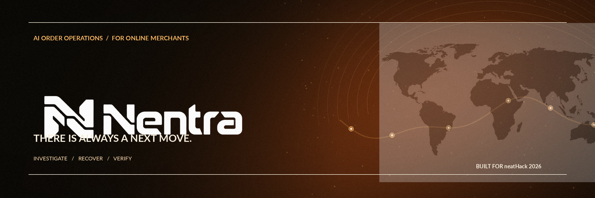
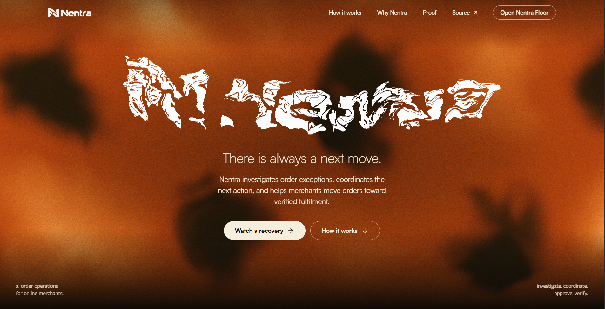
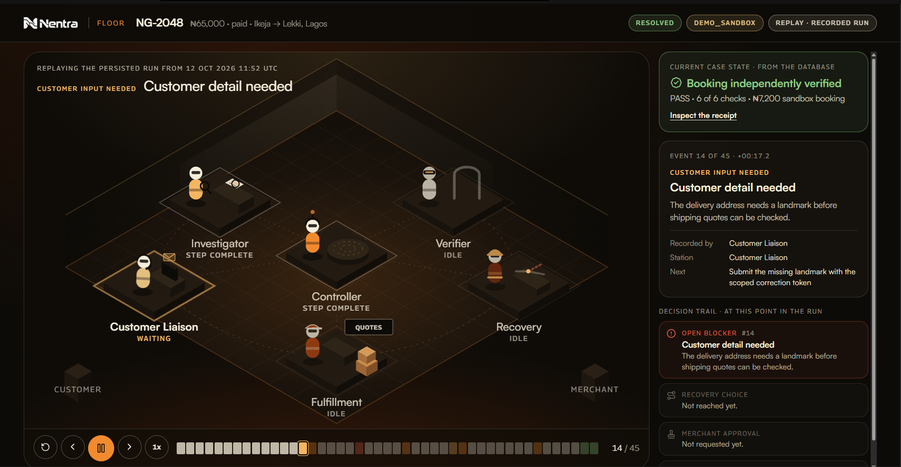
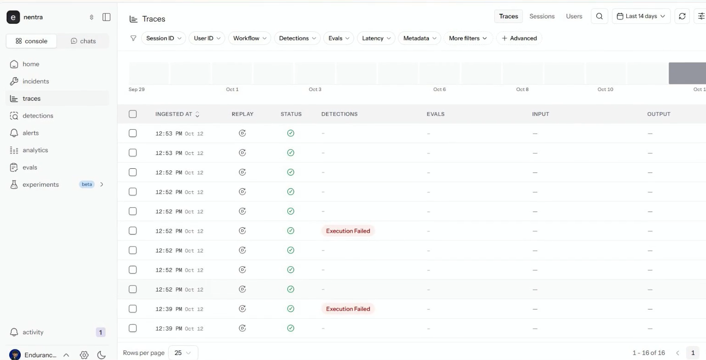
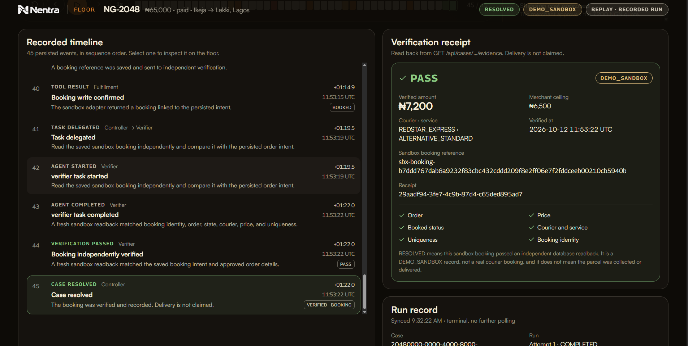
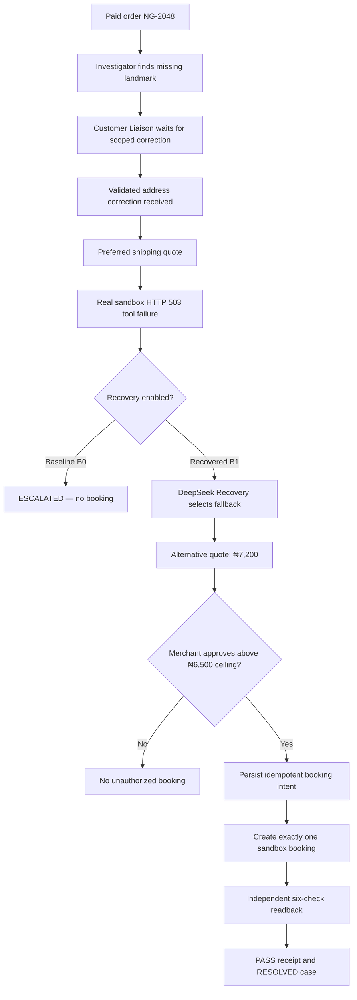
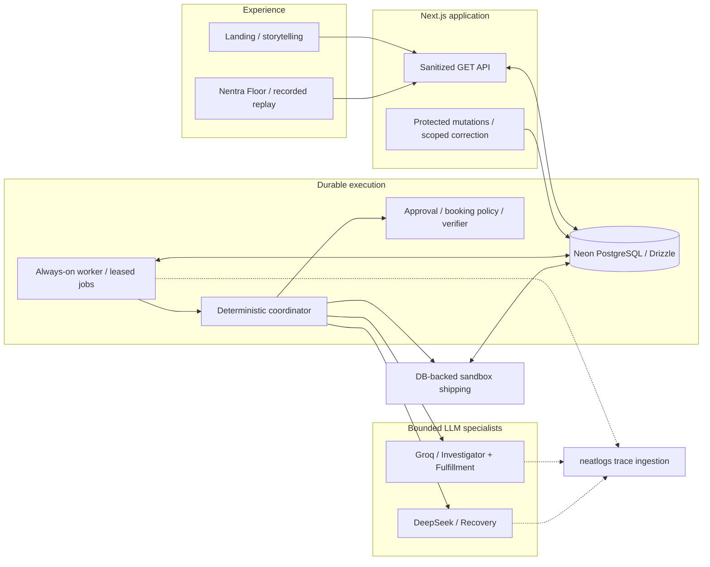

<div align="center">

<a href="https://usenentra.vercel.app/app" title="Explore the Nentra operations floor">
  
</a>

<br />

### When an order hits a snag, Nentra works the next move.

**A visible, merchant-controlled AI operations team for stuck online orders.**  
Investigate exceptions. Coordinate specialist agents. Recover safely. Verify the result.

<br />

[](https://usenentra.vercel.app/app)
[](https://drive.google.com/file/d/1gXskhuHECgFJuNr2wksxHU75hfRfqPzF/view)
[](https://docs.google.com/document/d/1TRdEl4Nfu1tUsM1P0QSZadC0sIqq58iLAMdG6zGtmww/edit)

[](https://github.com/Devendurance/nentra/stargazers)
[](https://github.com/Devendurance/nentra/commits/main)
[](./LICENSE)
[](https://github.com/Devendurance/nentra/issues)
[](./package.json)
[](./tsconfig.json)
[](https://neatlogs.com/hackathon)

**[Website](https://usenentra.vercel.app)** · **[Recorded recovery](https://usenentra.vercel.app/app)** · **[Evidence hub](https://docs.google.com/document/d/1TRdEl4Nfu1tUsM1P0QSZadC0sIqq58iLAMdG6zGtmww/edit)** · **[Architecture](./docs/architecture.md)** · **[Technical reference](./docs/backend.md)** · **[Financial model](https://cfo.ai/s/JWutqlALbqlFRbsd)**

</div>

---

## The sale is made. The order is stuck.

For a small online seller in Nigeria, making a sale is only the beginning. A missing delivery landmark, an unavailable courier, or a shipping quote above budget can turn an ordinary order into hours of calls, WhatsApp messages, manual checks, and follow-ups.

Most tools tell the merchant **that something went wrong**. The merchant is still expected to investigate, coordinate people, choose alternatives, approve spending, and establish whether the fix worked.

**Nentra works through that operational problem.** Its coordinator delegates bounded work to specialist agents, makes failures observable, asks for human approval at consequential decision points, and independently checks the outcome. The merchant can see the work instead of taking an agent's “done” message on trust.

The current product demonstrates this on one **fictional, pre-dispatch Lagos order**. It uses real LLM inference, real persisted workflow state, real observability, and an explicitly simulated shipping provider. No real parcel delivery is claimed.

### See the working product in 60 seconds

1. Open **[Nentra Floor](https://usenentra.vercel.app/app)**, the read-only viewer for the recorded `NG-2048` run.
2. Press **Play** or step through the event timeline. Watch the six agent stations react to **recorded events**, not scripted fake activity.
3. Stop at **event #20**, where the preferred courier quote fails with `PROVIDER_503`.
4. Continue to the fallback and merchant approval. Nentra needs approval for **₦7,200** against a **₦6,500** shipping ceiling.
5. Finish at the persisted booking and independent **`PASS`** receipt. The case is `RESOLVED` in **`DEMO_SANDBOX`**, not marked as delivered.

> **Product truth:** `/app` currently replays an already completed workflow and can observe event updates. It does not let public visitors start, reset, approve, or dispatch real orders. Protected operator mutations exist in the backend; the shipping adapter is a sandbox.

## A product you can see working

<!-- Replace the PNG files below with actual verified screenshots. Keep the same filenames and this gallery will update automatically. -->

<table>
  <tr>
    <td width="50%" align="center"><b>01 · The landing experience</b><br /><sub>Cinematic Nentra identity and recorded-case storytelling</sub><br /></td>
    <td width="50%" align="center"><b>02 · The living operations floor</b><br /><sub>Six specialist stations, event replay, decisions and timeline</sub><br /></td>
  </tr>
  <tr>
    <td align="center"><b>03 · A failure becomes a recovery</b><br /><sub>Recorded courier HTTP 503 and bounded fallback</sub><br /></td>
    <td align="center"><b>04 · Proof, not a promise</b><br /><sub>One sandbox booking and independently checked receipt</sub><br /></td>
  </tr>
</table>


## One order. Six specialists. An observable recovery.

The Nentra MVP follows **`NG-2048`**, a fictional **₦65,000** order traveling from **Ikeja to Lekki, Lagos**. Its address is missing a landmark. Then the preferred shipping provider returns a persisted sandbox **HTTP 503**.

| Specialist | Responsibility | Current implementation |
|---|---|---|
| **Controller** | Coordinate the state machine, delegate work, enforce step boundaries | Deterministic orchestration |
| **Investigator** | Check address completeness and identify missing information | Real **Groq / `openai/gpt-oss-20b`** decision in the verified run |
| **Customer Liaison** | Request missing details and wait for a scoped correction | Persisted waiting state and secure correction API; **no WhatsApp delivery yet** |
| **Fulfillment** | Request quotes, assess eligible options and prepare guarded booking | Real **Groq / `openai/gpt-oss-20b`** decisions plus sandbox tools |
| **Recovery Specialist** | Classify a failed tool call and choose a bounded alternative or escalation | Real **DeepSeek / `deepseek-flash`** decision in the verified run |
| **Verifier** | Independently read back a booking and compare it against the approved intent | Deterministic six-check verification and durable receipt |

The LLMs provide **bounded recommendations**, while deterministic code owns state transitions, authorization, idempotency, monetary limits, and verification.

### The recorded journey



The reference run demonstrates the **approved** B1 branch. Other diagram branches describe implemented safeguards or comparative modes; they are not extra real-world shipments.

### Reproducible B0 / B1 behavior

| Same fictional exception | **B0 · Baseline** | **B1 · Recovery enabled** |
|---|---|---|
| Failure | Preferred shipping quote returns `PROVIDER_503` | Same configured failure |
| Specialist response | Escalate without fallback | Evaluate alternative and continue behind guardrails |
| Merchant spending approval | No booking | Required before the above-ceiling booking |
| Final case state | **`ESCALATED`** | **`RESOLVED`** |
| Persisted events | **21** | **45** |
| Sandbox bookings | **0** | **1** |
| Independent verification | No `PASS` receipt | **1 `PASS` receipt, 6 checks** |

These are observed results from a **baseline/recovered configuration comparison**, not an assertion that two different historical code revisions were benchmarked. The shipping failure remains a genuine error span even when subsequent recovery succeeds.

## The important engineering decisions

- **Durable execution:** PostgreSQL stores cases, tasks, run state, events, quotes, approvals, job leases, booking intents, and verification receipts. Work continues in a separate long-running worker rather than a browser tab.
- **Guarded autonomy:** structured, schema-validated specialist decisions cannot bypass deterministic spending, eligibility, or approval checks.
- **A recoverable failure:** the sandbox adapter persists a controlled, one-shot `503` failure, allowing the Recovery Specialist to evaluate a recorded exception rather than an invented animation.
- **Human authorization:** a fallback above the merchant's **₦6,500** threshold pauses for explicit approval of the actual **₦7,200** proposal.
- **Booking exactly once:** an idempotency key and persisted booking intent prevent unsafe blind retries after an ambiguous write. The verified scenario contains one booking.
- **Independent proof:** the verifier checks booking identity, order, courier/service, price, booked status and uniqueness before issuing `PASS`.
- **A truthful interface:** the 2.5D Floor is a client-side projection of ordered, stored events. Replay controls do not start or simulate new backend work.
- **Traceable execution:** neatlogs captures workflow, tool and LLM activity, including the handled failure. Span summaries are redacted rather than dumping customer data.

## System architecture



**Deployed topology:** [Vercel](https://usenentra.vercel.app) serves the public Next.js experience/API, a separate worker runs on **AWS EC2**, and **Neon PostgreSQL** is the shared source of truth. Entire tracks development provenance and cfo.ai holds the financial model; neither is falsely presented as a runtime shipping integration.

### Technology stack

| Layer | Technology |
|---|---|
| Frontend | Next.js 16.4 App Router, React 19, TypeScript, Tailwind CSS 4 |
| Brand and interaction | GSAP / ScrollTrigger, CSS/SVG animation, Satoshi, Georama, Instrument Serif |
| Agent orchestration | TypeScript worker, persisted jobs, lease fencing/heartbeats, deterministic state machine, Zod contracts |
| Inference | Groq for Investigator/Fulfillment, DeepSeek for Recovery, optional OpenAI-compatible fallback |
| Data | PostgreSQL via Neon, Drizzle ORM and committed migrations |
| Shipping | Database-backed **`DEMO_SANDBOX`** provider with failure injection and idempotent booking |
| Observability | neatlogs SDK with real workflow, tool, agent and model traces |
| Development provenance | Entire checkpoint associated with a genuine Pi coding session |
| Business planning | cfo.ai interactive financial model, exported workbook and one-page business plan |
| Hosting | Vercel public app/API; AWS EC2 long-running worker |
| Verification | Vitest, PGlite integration tests, ESLint, TypeScript, Next.js build |

## neatHack 2026: three partner integrations, three distinct jobs

<table>
<tr><th>Partner</th><th>What Nentra actually used it for</th><th>Judge evidence</th></tr>
<tr>
<td><b><a href="https://neatlogs.com">neatlogs</a></b></td>
<td>Instrumented real agent and tool execution; exposed the <code>shipping_quotes</code> 503, traced the subsequent recovery, and helped diagnose missing outputs in successful spans. The red failing tool span remains a real failure.</td>
<td><a href="https://docs.google.com/document/d/1TRdEl4Nfu1tUsM1P0QSZadC0sIqq58iLAMdG6zGtmww/edit">Trace IDs, screenshots and explanation</a> · <a href="./evidence/neatlogs/tracing-correction.md">Instrumentation fix</a></td>
</tr>
<tr>
<td><b><a href="https://entire.io">Entire</a></b></td>
<td>Captured a real Pi development session and associated checkpoint <code>01M4RDHBN8Z60Q0MVVS35EG3MK</code> with commit <code>a9d6aeb</code>. No retrospective capture is claimed.</td>
<td><a href="https://github.com/Devendurance/nentra/commit/a9d6aeb207e86f156a6be0ad0c83ac489ea4b826">Checkpoint-linked commit</a> · <a href="https://docs.google.com/document/d/1TRdEl4Nfu1tUsM1P0QSZadC0sIqq58iLAMdG6zGtmww/edit">Session evidence</a></td>
</tr>
<tr>
<td><b><a href="https://cfo.ai/s/JWutqlALbqlFRbsd">cfo.ai</a></b></td>
<td>Built an actual interactive business model with merchant pricing, inference and operating costs, base/downside/upside scenarios, sensitivity analysis, break-even and runway. Figures are forecasts, not traction.</td>
<td><a href="https://cfo.ai/s/JWutqlALbqlFRbsd">Interactive model</a> · <a href="https://drive.google.com/file/d/180GfcePYxSfKHmhXIkEjgA-8e8-ASZQM/view">Workbook</a> · <a href="https://drive.google.com/file/d/1SRJQd9sL-A1Yu0Slte8S0uV1fU-MOAMb/view">Business plan</a></td>
</tr>
</table>

### Commercial reality, clearly labeled

The cfo.ai model explores **hypothetical** monthly plans at **₦20,000 per merchant**. Nentra had **no paying customers or recorded revenue** at the time of the hackathon.

| Model scenario | Hypothetical merchants | Subscription revenue / month | Modeled operating result / month |
|---|---:|---:|---:|
| Downside | 20 | ₦400,000 | **−₦1,001,654** |
| Base | 50 | ₦1,000,000 | **−₦644,642** |
| Upside | 150 | ₦3,000,000 | **+₦1,021,485** |

The model estimates full-cost break-even at **88 merchants**, contingent on its unvalidated cost, FX, volume and acquisition assumptions. Inference is only one part of the cost structure. See the [live financial model](https://cfo.ai/s/JWutqlALbqlFRbsd) for sources, formula details and sensitivities.

## Run it locally

### Requirements

- Node.js **22+** and npm
- PostgreSQL **14+**, or a disposable Neon database you control
- Optional Groq, DeepSeek, and neatlogs credentials for **real model/trace execution**

> **Safety first:** The seed/reset script replaces the fictional demo fixture in the configured database. Never run it against the production Neon database that holds the public `NG-2048` recording. Use an isolated database.

```bash
# 1. Get the source
git clone https://github.com/Devendurance/nentra.git
cd nentra

# 2. Install deterministic dependencies
npm ci

# 3. Prepare local server-only configuration
cp .env.example .env
# Set DATABASE_URL to a disposable PostgreSQL database.
# Set NENTRA_DEMO_OPERATOR_SECRET to a long random secret.
# Optionally add GROQ_API_KEY, DEEPSEEK_API_KEY and NEATLOGS_API_KEY.

# 4. Apply committed migrations, then seed the fictional case
npm run db:migrate
npm run db:seed

# 5. Start the web app and worker in separate terminals
npm run dev
# In terminal two: npm run dev:worker
```

Then open **http://localhost:3000** or **http://localhost:3000/app**. The local Floor reads its data from your configured database. The worker is required to execute queued steps, not to view an already completed replay.

**Windows PowerShell:** replace `cp .env.example .env` with `Copy-Item .env.example .env`. Keep the `.env` file private. The seed command returns a one-time correction token; never share it publicly.

### Configure the provider keys

| Environment variable | Purpose |
|---|---|
| `DATABASE_URL` | Required PostgreSQL connection, shared by the web/API and worker |
| `NENTRA_DEMO_OPERATOR_SECRET` | Server-only authentication for protected demo mutations |
| `NENTRA_MODE=DEMO_SANDBOX` | Explicit simulator mode; no production shipping is implied |
| `NENTRA_RECOVERY_MODE=RECOVERED` | B1 fallback path; switch to `BASELINE` only when intentionally reproducing B0 in a disposable fixture |
| `GROQ_API_KEY` | Real Groq execution for Investigator and Fulfillment |
| `GROQ_MODEL` | Default `openai/gpt-oss-20b` |
| `DEEPSEEK_API_KEY` | Real DeepSeek execution for Recovery |
| `DEEPSEEK_MODEL` | Default `deepseek-flash` |
| `NEATLOGS_API_KEY` | Real SDK instrumentation and trace ingestion |
| `OPENAI_API_KEY` + `OPENAI_MODEL` | Optional, together enable the compatible provider fallback |

Without LLM credentials, the specialist contracts have a **deterministic fallback**. A configured provider failure is not silently represented as a successful real model call. Without a neatlogs key, no external trace evidence is claimed. See the complete [environment and runtime guide](./docs/backend.md) and [`.env.example`](./.env.example).

### Reproduce a complete workflow safely

A newly seeded case begins as `NEW`. Protected start queues work. The worker enters `WAITING_CUSTOMER` after the Investigator finds the missing landmark. The secure correction endpoint accepts the **one-time token** returned to the authorized seeding operator. The preferred quote then records the `503`, and in `RECOVERED` mode the case waits for approval of the exact alternative. A protected approval allows the booking step to execute, followed by independent verification.

If you want to run persisted jobs in batches instead of keeping a worker open, use `npm run demo:run -- <CASE_ID>`. The command drains currently ready steps and stops at a human gate, terminal state or step budget. All approval/correction calls must use the existing authorization model; do not put operator secrets in the browser.

To compare B0 and B1, independently reseed **only a disposable local database** between runs, change the recovery mode on the worker before the new run, and preserve separate trace evidence for each. Do not overwrite the published B1 receipt.

### Public API (sanitized and guarded)

| Method | Route | Access / outcome |
|---|---|---|
| `GET` | `/api/cases` | Public sanitized case list |
| `GET` | `/api/cases/:caseId` | Sanitized case snapshot |
| `GET` | `/api/cases/:caseId/events?after=0` | Ordered recorded events / cursor polling |
| `GET` | `/api/cases/:caseId/evidence` | Sanitized verification receipts |
| `POST` | `/api/cases/:caseId/start` | Operator secret required; queues a durable run |
| `POST` | `/api/cases/:caseId/approvals/:approvalId` | Operator secret required; bounded decision |
| `POST` | `/api/cases/:caseId/cancel` | Operator secret required; safe cancellation boundary |
| `POST` | `/api/customer-corrections/:token` | Single-use scoped token; validates missing address information |
| `POST` | `/api/demo/reset` | Operator secret required; **destructive demo reset** |

The public `/app` route uses **GET requests only**. Mutation routes aren't an invitation to modify the hosted demonstration. The API reference, request bodies and failure codes are in [docs/backend.md](./docs/backend.md).

### Test and quality gates

```bash
npm test               # Vitest; tests use isolated PGlite, not production Neon
npm run type-check     # Strict TypeScript
npm run lint           # ESLint
npm run build          # Next.js production build
```

The latest landing-completion milestone reported **120 passing tests**, with TypeScript, lint, build and browser checks passing. GitHub badges above do **not** imply a hosted CI pipeline or verified uptime. Schema changes use `npm run db:generate` followed by `npm run db:migrate`; never use `drizzle push`.

## Navigate the repository

```text
src/
  app/
    page.tsx                    Cinematic landing experience
    app/                        Nentra Floor and case route
    api/                        Case reads, protected actions, scoped correction
  components/
    landing/                    Hero, scroll walkthrough, story, bento, footer
    floor/                      Stations, projections, replay, timeline, evidence
  agents/index.ts               Zod-validated specialist definitions and routing
  worker/                       Durable step coordinator and leased job worker
  domain/                       Status, recovery, approvals, booking verification
  integrations/
    llm/                        Groq, DeepSeek and compatible fallback
    shipping/                   Database-backed sandbox quote and booking adapter
    neatlogs/                   Trace wrappers and safe span outputs
  server/db/                    Drizzle schema, repository and SQL access
scripts/                        Migrations, fixture seeding and demo runner
migrations/                     Committed Drizzle migrations
tests/                          Domain, agent, API, floor and integration tests
docs/                           Product, technical and architecture specs
evidence/                       Sponsor and demo verification notes
```

For deeper technical review: [PRD](./docs/PRD.md) · [TRD](./docs/TRD.md) · [Architecture](./docs/architecture.md) · [Backend guide](./docs/backend.md) · [Design system](./DESIGN.md) · [Judges' evidence](./docs/hackathon-demo-evidence.md).

## Shipped, demonstrated and next

## Since the first submission: Telegram-powered order recovery

Nentra's first release demonstrated how six specialist agents could investigate a stuck order, recover from a shipping-provider failure, request merchant approval, create one sandbox booking and independently verify the outcome.

The next milestone connected that workflow to a real customer conversation.

**On October 15, 2026, Nentra completed its first verified Telegram-powered order recovery in staging.**

### A real customer conversation. A verified recovery.

For the fictional Lagos order `NG-2048`, Nentra completed the following sequence:

| Stage | Verified result |
|---|---|
| Customer connection | Telegram bot `/start` authenticated and linked through an expiring, single-use order-binding token |
| Customer consent | Explicit `OPTED_IN` consent persisted with the linked chat identity |
| Customer outreach | One real Telegram `sendMessage` accepted, with a provider message ID |
| Customer response | `LANDMARK: Admiralty Way` received through the authenticated Telegram webhook |
| Correction | Landmark validated and applied to the existing order |
| Workflow continuation | The same recovery run resumed from `WAITING_CUSTOMER` to `QUOTING` |
| Shipping recovery | Alternative `REDSTAR_EXPRESS` quote evaluated at ₦7,200, above the ₦6,500 merchant ceiling |
| Human authorization | Expired quote refreshed and the new exact-price proposal explicitly approved |
| Booking | Exactly one `DEMO_SANDBOX` booking recorded |
| Verification | Independent `PASS` receipt with all six checks satisfied |
| Final outcome | Case `RESOLVED`; run `COMPLETED`; no outstanding or dead-letter jobs |

This was a real Telegram customer interaction against the staging application and database. The order and shipping provider remained fictional, and the final booking was simulated. No real-world parcel dispatch or Telegram delivery/read receipt is claimed.

### What's now implemented

**Telegram Customer Liaison**
- Real Telegram Bot API integration, authenticated webhooks and private-chat validation.
- Secure, single-use order binding and explicit customer consent.
- Encrypted chat identifiers and keyed contact lookups.
- Durable inbound deduplication, outbound idempotency and bounded failure handling.
- Customer correction validation that resumes the existing workflow rather than creating a new run.
- Persisted message lifecycle evidence projected onto the Nentra Floor.

**Merchant-controlled approval**
- An operator-authenticated Merchant Approval panel inside the Floor.
- Exact courier, service, price, spending ceiling, difference and expiry displayed before approval.
- Server-enforced rejection of expired or mismatched quotes.
- Safe quote refresh that preserves historical approvals and produces a fresh, auditable proposal.
- Explicit Approve/Reject actions without bypassing the original booking policy.

**Preserved engineering guarantees**
- Six specialist agent stations with bounded responsibilities.
- PostgreSQL-backed execution, job leasing and event history.
- Shipping-provider failure classification and controlled fallback.
- Human authorization for spending above merchant limits.
- Idempotent booking intent and sandbox booking.
- Independent six-check verification and durable evidence receipts.
- Original neatlogs, Entire and cfo.ai hackathon evidence retained.

### Deployment and evidence boundaries

The initial production `NG-2048` recording and the later Telegram-enabled staging run are separate persisted demonstrations.

Promoting the new code and database schema to production does not copy staging conversations, customer identities, bookings or evidence into production.

The original submitted recording remains available at [usenentra.vercel.app/app](https://usenentra.vercel.app/app). The Telegram-enabled release adds capabilities while preserving that reference demonstration.

WhatsApp inbound integration was verified with a real Twilio message, but outbound testing encountered a Twilio API rejection. WhatsApp remains disabled for the production release; Telegram is the selected primary customer-messaging integration.

### What's next

The next product milestones are production Telegram onboarding, a dedicated merchant workspace, authenticated multi-merchant operations, real shipping-provider integrations and stronger operational monitoring.

**Nentra's operating principle remains the same: investigate the exception, recover within policy, ask a human when required, and prove what actually happened.**

## Contributors and use

Built by **[Endurance Udoh](https://github.com/Devendurance)** for **neatHack 2026**. The project prioritizes inspectable engineering, bounded agent decisions, merchant control and evidence over polished but unverifiable claims.

Contributions and thoughtful issues are welcome through [GitHub Issues](https://github.com/Devendurance/nentra/issues). Please read [`AGENTS.md`](./AGENTS.md) and [`DESIGN.md`](./DESIGN.md) before changing implementation or UI. Never commit `.env`, API keys, customer records or private trace exports.

### License and third-party assets

The original repository code is offered under the **[MIT License](./LICENSE)**, copyright **2026 Endurance Udoh**. External services, third-party fonts, media, logos and trademarks remain subject to their respective licenses and terms. Nentra's brand artwork and third-party service marks are not automatically relicensed for unrelated use merely because code is MIT-licensed. Review applicable rights before redistributing assets.

<div align="center">
  <hr />
  <a href="https://usenentra.vercel.app"></a>
  <h3>There is always a next move.</h3>
  <sub>Built for merchants whose orders need action, not another alert.</sub>
  <p><a href="https://usenentra.vercel.app/app">Explore the Floor</a> · <a href="https://cfo.ai/s/JWutqlALbqlFRbsd">Business Model</a> · <a href="https://docs.google.com/document/d/1TRdEl4Nfu1tUsM1P0QSZadC0sIqq58iLAMdG6zGtmww/edit">Judge Evidence</a> · <a href="#the-sale-is-made-the-order-is-stuck">Back to the story ↑</a></p>
</div>
