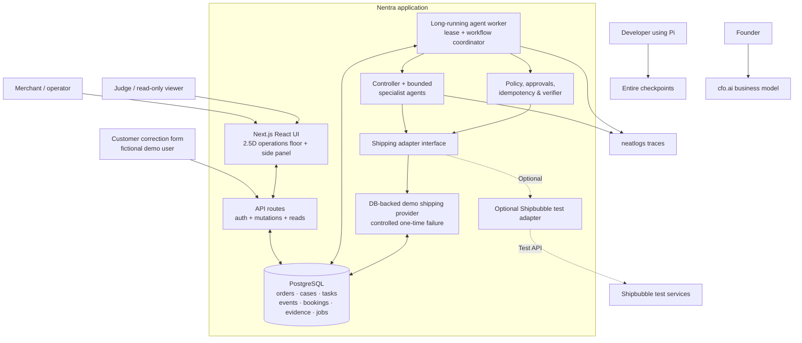
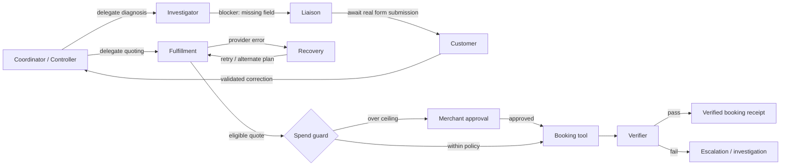
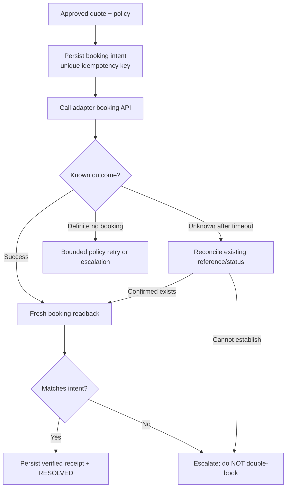

# Nentra — System Architecture

> **Version:** 1.0 — 11 October 2026  
> **System:** Nentra, autonomous visual exception-resolution platform for Nigerian online merchants  
> **MVP scope:** Fictional Lagos pre-dispatch order → customer address correction → quote failure → agent recovery → authorized shipment booking → independent verification  
> **Companion specs:** [`PRD.md`](PRD.md) · [`TRD.md`](TRD.md) · [`projectplan.md`](projectplan.md)

## 1. Architectural decisions (ADRs)

| ADR | Decision | Rationale | Revisit when |
|---|---|---|---|
| A-01 | Single TypeScript monorepo, one full-stack Next.js app + worker | Fast build, shared contracts | Multiple teams/scaling requirements |
| A-02 | PostgreSQL as canonical durable store + job queue | Consistent transitions, no extra infrastructure | High parallel workload |
| A-03 | Deterministic workflow coordinator with bounded specialist LLM agents | Real delegation without unsafe free-form automation | Proven complex agent task variety |
| A-04 | Server-persisted event journal drives visual world | Replay and truthfulness | Very high event-throughput needs |
| A-05 | Polling event deltas (~1 second) rather than immediate WebSocket dependency | Minimal infra; enough for demo | Need subsecond real-time at scale |
| A-06 | Sandbox shipping adapter is first-class and always labeled | Reliable demo, no implied production shipments | Live provider integration verified |
| A-07 | Verification is independent of planner and booking response | Protect against hallucinated completion | Never remove; strengthen for production |
| A-08 | Separate long-running worker from request handlers | Browser refresh/serverless limitations don't interrupt case | Managed queue replaces worker loop |
| A-09 | cfo.ai and Entire used in their appropriate build/business roles | No artificial runtime integration | Official integrations become useful |

### Design principles

- **Action over explanation:** an agent must perform real scoped tool work.
- **Trust over autonomy theater:** human approval for consequential actions, no fake success or hidden retries.
- **One source of truth:** database owns cases, bookings, tasks, events and evidence.
- **Visual projection:** characters and task movement represent persisted work; animation does not control execution.
- **Small enough to finish:** one bounded recovery workflow before integrations or extra scenarios.

## 2. Context and logical architecture



*Dotted edges are optional/test integrations. Neither Entire nor cfo.ai is required to run merchant cases; both are required for hackathon evidence.*

## 3. Runtime topology and deployment

### Preferred MVP deployment

- **Web process:** Next.js Node server, serving pages and route handlers.
- **Worker process:** separate Node process in the same long-lived container/service (or separate service if host supports easy dual deployments).
- **Database:** hosted PostgreSQL; share `DATABASE_URL` with web/worker; use migrations.
- **LLM service:** OpenAI-compatible API from official neatHack LiteLLM key if actually issued; do not invent URL/model names.
- **neatlogs:** server-side SDK initialized in worker; no API key in browser.
- **Assets:** static SVG/PNG character art and CSS layers served by Next.js.

**Why not Vercel-only background jobs?** A multi-step workflow that pauses for customer input or has retries must not rely on a request handler staying alive after the client disconnects. A continuously running worker with durable jobs is the MVP answer. If using Vercel for UI, place worker on an always-on runtime and keep the same DB/API contract.

### Logical deployment

```text
                               Public HTTPS
                                    │
                              ┌─────▼──────┐
                              │ Web / API  │  Next.js Node
                              └─────┬──────┘
                                    │ SQL
                           ┌────────▼────────┐
                           │   PostgreSQL    │
                           │ durable events  │
                           │ jobs + bookings │
                           └────────▲────────┘
                                    │ SQL lease + commits
                           ┌────────┴────────┐
                           │ Worker process  │
                           │ agents + tools  │
                           └──────┬─────┬────┘
                                  │     │
                   ┌──────────────┘     └──────────────┐
                   ▼                                   ▼
             Model endpoint                      neatlogs ingest
                   │
                   ▼
             Shipping adapter ──► sandbox DB / optional Shipbubble test

       Entire: git/Pi development checkpoint plane (outside runtime)
       cfo.ai: business analysis/evidence plane (outside runtime)
```

### Build/deploy configuration

- Use separate `npm run dev:web` and `npm run dev:worker` during development.
- A persistent host can run both with `npm run start:web` + `npm run start:worker` under a supervisor, or deploy two process types.
- Deploy a public demo with **read-only viewer access** and a protected operator route for reset/start/approval.
- Use fictional Nigerian business/customer records only; **never** expose provider secrets in static environment variables prefixed `NEXT_PUBLIC_`.
- If worker can't reach DB or model service, surface `PAUSED/ESCALATED` rather than making the front end pretend it progressed.

## 4. Source tree (recommended)

```text
nentra/
├── app/
│   ├── page.tsx                       # positioning + demo entry
│   ├── app/page.tsx                   # cases overview
│   ├── app/cases/[id]/page.tsx        # live floor
│   ├── c/[token]/page.tsx             # scoped address-correction portal
│   └── api/
│       ├── cases/                    # queries, start, events, approvals
│       ├── customer-corrections/     # correction input
│       └── demo/reset/               # protected reset
├── components/
│   ├── operations-floor/             # isometric scene, actors, task token
│   ├── activity-panel/               # typed agent/status/event cards
│   └── evidence/                     # verification + case receipt
├── domain/
│   ├── cases/                        # states, transitions, invariants
│   ├── orders/                       # eligibility and address rules
│   ├── recovery/                     # policy + retry classification
│   ├── shipping/                     # quote/booking domain and interface
│   ├── verification/                 # independent checks
│   └── events/                       # event schema and projections
├── agents/
│   ├── controller.ts
│   ├── investigator.ts
│   ├── liaison.ts
│   ├── fulfillment.ts
│   ├── recovery.ts
│   ├── verifier.ts
│   └── contracts.ts                  # role-specific Zod outputs/tools
├── integrations/
│   ├── llm/                           # provider client + models
│   ├── neatlogs/                      # tracing wrappers / sanitization
│   ├── shipping/demoAdapter.ts        # required DB-backed provider
│   └── shipping/shipbubbleAdapter.ts  # optional test integration
├── server/
│   ├── db/schema.ts
│   ├── db/repositories.ts
│   ├── jobs/queue.ts
│   ├── auth/                           # operator / customer scopes
│   └── api/validators.ts
├── worker/
│   ├── main.ts                        # polling loop + lease claims
│   └── coordinator.ts                 # persisted workflow transitions
├── scripts/
│   ├── seed-demo.ts
│   ├── reset-demo.ts
│   └── verify-evidence.ts
├── tests/
│   ├── domain/
│   ├── integration/
│   └── e2e/
├── evidence/
│   ├── traces/                         # actual IDs/screenshots
│   ├── entire/                         # actual checkpoint screenshots/links
│   ├── cfo/                            # actual business-plan export
│   └── comparisons.md
├── .env.example
├── PRD.md
├── TRD.md
├── architecture.md
└── projectplan.md
```

Keep modules as small as needed. This is a target layout, not an instruction to generate empty folders/files prematurely.

## 5. Workflow boundary: controller vs specialist agents

### Coordinator (deterministic)

Owns lifecycle, database writes, authorization and next safe step. It may ask an LLM controller to plan/delegate, but **only typed, allowlisted actions** can be executed. The coordinator persists a task and executes the selected specialist with minimum necessary context.

### Specialists (real work)

- **Investigator:** read order/address; return blockers and required correction fields.
- **Liaison:** create secure correction request, pause for customer input.
- **Fulfillment:** request eligible quotes, compare within merchant constraints.
- **Recovery:** inspect tool failure, choose bounded retry/fallback, create new task; cannot bypass approval.
- **Verifier:** perform fresh provider readback, compare against persisted approved booking intent, append pass/fail evidence.

Implement **at least two** as independent LLM-backed role executions, plus deterministic role steps as appropriate. Every role drawn on the floor must correspond to a real step; do not imply simultaneous agents if work is sequential.

### Agent boundaries



## 6. Main sequence: truthfully visible rescue

```mermaid
sequenceDiagram
    autonumber
    participant Merchant
    participant UI as Live Floor / Right Rail
    participant API
    participant DB as Postgres
    participant W as Worker / Agents
    participant Customer
    participant Ship as Shipping Adapter
    participant NL as neatlogs

    Merchant->>UI: Start fictional order NG-2048
    UI->>API: POST /cases/{id}/start
    API->>DB: Insert run + runnable job
    API-->>UI: 202 accepted + current snapshot
    W->>DB: Lease job + begin phase
    W->>NL: Begin workflow trace segment
    W->>DB: Persist controller delegation event
    W->>DB: Persist investigation tool outcomes
    DB-->>UI: GET new events (poll)
    UI->>UI: Avatar walks to investigation station
    W->>DB: Create correction request; WAITING_CUSTOMER
    UI-->>Merchant: Needs recipient detail
    Customer->>API: Submit valid correction token
    API->>DB: Update address + new job + event
    W->>DB: Resume and delegate Fulfillment
    W->>Ship: getQuotes(primary)
    Ship--xW: Controlled 503 error (sandbox fixture)
    W->>DB: Persist TOOL_FAILED + recovery delegation
    DB-->>UI: Event update: agent fails, recovery avatar moves
    W->>Ship: getQuotes(eligible fallback)
    Ship-->>W: Eligible quotes
    W->>DB: Apply policy; require approval if necessary
    Merchant->>API: Approve exact extra-cost proposal if needed
    API->>DB: Persist approved proposal and queue
    W->>Ship: bookShipment(idempotencyKey)
    Ship-->>W: booking reference
    W->>Ship: getBooking(reference)
    Ship-->>W: independent booking readback
    W->>DB: Persist receipt + RESOLVED event atomically
    W->>NL: Finalize/flush trace segment(s)
    DB-->>UI: Events + receipt
    UI-->>Merchant: Verified booking; evidence, not delivery
```

**Clarification:** a run can pause for customer/merchant input. A neatlogs `WORKFLOW` root naturally covers each **continuous worker execution segment**, not necessarily the entire multi-hour case across suspended processes. Correlate segments using `caseId/runId` metadata and list their actual trace links. For the before/after contest comparison, compare equivalent recovery segments or complete staged runs consistently. Never invent one giant trace if the SDK did not produce it.

## 7. Event-driven 2.5D visualization

### Event → station projection

| Real backend event | Floor animation | Right-rail information |
|---|---|---|
| `CASE_STARTED` | Parcel/task appears at intake | Goal, order amount, owner |
| `TASK_DELEGATED` | Task token travels to target agent | Who delegated, why, task ID |
| `AGENT_STARTED` | Specialist walks to workstation and begins work | Role + concise objective |
| `TOOL_CALLED` | Workstation activity + subtle loading | Tool name, attempt, time |
| `TOOL_FAILED` | Station enters error state; task remains blocked | Error classification and evidence |
| `RETRY_SCHEDULED` | Recovery token follows next route | Retry count and safe policy |
| `FALLBACK_SELECTED` | Token reroutes to alternative station/provider | Eligible option and reason |
| `CUSTOMER_INPUT_REQUIRED` | Liaison waits at desk; visible pause | Correction link/status |
| `APPROVAL_REQUIRED` | Task waits at approval station | Cost delta, exact proposal |
| `BOOKING_CREATED` | Confirmation token moves to verifier | Adapter mode + booking ID |
| `VERIFICATION_PASSED` | Verifier stamps pass; receipt appears | Readback checks and result |
| `CASE_ESCALATED` | Agent stops; human-needed indicator | Why automatic recovery stopped |

**No event, no animation.** Use explicit semantic actor/target/station mapping, not a timer driving a predetermined story.

### Animation and replay mechanics

1. API returns latest snapshot and events sorted by server-assigned `seq`.
2. Client stores a monotonic `lastSeq`; polls `/events?after={lastSeq}`.
3. Projection reducer computes each agent's current station/animation state from event list.
4. Animated transitions interpolate between floor coordinates. Animation duration affects presentation only; business execution is independent.
5. On tab restore/reconnect, fetch authoritative snapshot and missed events; snap or replay without making new changes.
6. On replay, use recorded event order and timestamps, with clearly labeled playback speed; never reissue tools/bookings.
7. Present event details accessibly as text for reduced-motion users.

### Suggested station world coordinates

```ts
const stations = {
  controller:   { x: 48,  y: 32 },
  investigator: { x: 220, y: 55 },
  liaison:      { x: 400, y: 48 },
  fulfillment:  { x: 235, y: 220 },
  recovery:     { x: 420, y: 230 },
  verifier:     { x: 620, y: 145 },
} as const;
```

Coordinates are starting layout values, not branded art direction. Keep text labels and a right-side timeline visible even if animation is disabled.

## 8. Persistence, concurrency, and transaction boundaries

### Durable job loop

```text
claim ready job (transaction; SKIP LOCKED)
  ↓
load case version, run, policy, task context
  ↓
execute one bounded step (LLM/tool, timeout + budget)
  ↓
transaction:
  validate current state/version
  write task attempt/result
  write state change + event(s)
  enqueue next job OR mark WAITING/terminal
  release/complete lease
  ↓
repeat for next runnable job
```

- Never hold a DB transaction open during external LLM or provider HTTP calls.
- Use compare-and-swap case `version` or row locks when committing state changes.
- Avoid running two active jobs for the same case. Deduplicate `start` API calls.
- Job leases expire on crashed worker; next worker resumes from persisted phase.
- For **write operations**, persist booking intent/idempotency key **before** calling the provider.
- On crash after external write, reconcile against provider/reference before making further writes.

### Booking transaction boundaries



The sandbox adapter can guarantee idempotency via the DB. The optional Shipbubble test adapter must not be claimed idempotent until the relevant provider behavior is verified.

### Sandbox fault design

- Demo seed creates `demo_faults(case_id, tool='quote_primary', remaining_failures=1, error_code='PROVIDER_503')`.
- First matching quote attempt atomically consumes the fault and returns/rejects with a typed error.
- That rejection creates a real `tool_attempt` and `TOOL_FAILED` event; neatlogs records the actual failed span.
- Recovery receives the failure metadata, not a canned UI script, and selects a permitted fallback route.
- Rerunning after a demo reset produces comparable input and error conditions.

## 9. Security, privacy and authorization

### Trust boundaries

```text
Untrusted inputs:
  customer correction fields, merchant requests, provider responses,
  LLM-generated decisions, even agent output JSON
          ↓ validate and sanitize
Trusted policy layer:
  allowed tool per role, approval, max cost, case status/version,
  idempotency, safe retry policy, verification
          ↓ authorized actions only
External write boundary:
  shipment booking (sandbox; optional provider test)
```

- Fictional data only in public hackathon build and screenshots.
- Treat model responses as untrusted. Validate Zod schemas and deterministic guards.
- A customer correction token grants only address correction for one case; hash token, expire it, one-time use.
- Separate public viewer from demo operator mutation powers; do not expose reset/start secrets in browser bundle.
- `NEATLOGS_API_KEY`, model key, DB credentials and shipping keys live server-side.
- Configure neatlogs redaction/masking; do not export genuine phone/address payloads or secrets.
- Never surface raw chain-of-thought, internal secret prompts or full provider error bodies to viewers.
- Obtain explicit approval for price overruns and live physical/financial consequences.

## 10. Observability and proof architecture

### Correlation IDs

Carry `merchantId` (fictional), `orderId`, `caseId`, `runId`, `taskId`, `toolAttemptId`, `providerBookingId`, `engineVersion`, `adapterMode` across events and trace metadata where safe. All IDs exposed to public viewers must be harmless internal IDs.

### neatlogs

- One actual workflow trace **per uninterrupted worker segment** with nested `AGENT`/`TOOL` spans and wrapped LLM calls.
- Capture error result, runtime metrics, attempt count and verified outcome.
- Multiple segments for a paused case are grouped in evidence with the same run/case identifier.
- Before/after evidence shows a real code change and two comparable fixed-input runs.

### Entire

- Entire captures Pi-assisted development sessions and checkpoints associated with actual Git commits.
- The public repo should show checkable progress after hackathon kickoff.
- Show `entire status`, checkpoint list or graph, and actual link/screenshot in `evidence/entire/`.

### cfo.ai

- Create real merchant SaaS economics outside runtime; export plan with assumptions and plausible scenarios.
- Describe it in demo as business validation/modeling, not as an operational step performed by an order-recovery agent.

### Judge evidence bundle

```text
evidence/
├── README.md                  # what each artifact proves
├── baseline/                  # B0 trace/screenshots/measurements
├── improved/                  # B1 trace/screenshots/measurements
├── entire/                    # actual checkpoints/graph output
├── cfo/                       # plan export or screenshots
├── recovery-case/             # event journal, receipt, adapter mode
├── demo-video-link.md         # public video location
└── submission-links.md        # X public build posts + quote submission
```

**Never fabricate trace IDs, successful test assertions, repo links or numerical improvements.** Leave placeholders until produced by the actual build.

## 11. Failures, edge cases and operational response

| Failure | Safe outcome | Visual truth |
|---|---|---|
| Missing customer address | `WAITING_CUSTOMER` | Liaison pauses, clear correction request |
| Primary quote 503 | Bounded retry/fallback | Error at fulfillment, Recovery receives handoff |
| Quote not eligible / COD unsupported | Exclude option; find valid route or escalate | Decision reason visible |
| Price over merchant ceiling | `WAITING_APPROVAL` | Task at approval desk; cannot book |
| Booking API timeout with unknown outcome | Reconcile or escalate, never blind write retry | "Booking outcome unconfirmed" |
| Duplicate start / rapid clicks | Return same active run | One task, not duplicated actors |
| Worker dies mid-step | Resume from durable job lease/checkpoint | Reconnect/resume, no fake continuity |
| Verifier gets mismatch | `ESCALATED`, no verified badge | Verifier flags issue with details |
| neatlogs ingestion fails | Business case still runs; evidence marked incomplete | Trace link unavailable, not invented |
| LLM offline/budget exhausted | Fail closed/queue or escalate | Model/tool unavailable, no hallucinated action |
| Provider test credentials invalid | Stay in labeled sandbox for MVP | No false live-provider badge |

## 12. Alternatives explicitly rejected for MVP

- **Phaser/Three.js as core UI:** high visual power but unnecessary complexity within the timebox; SVG/CSS can provide convincing 2.5D.
- **Microservice mesh:** high overhead and deployment failure surface for one workflow.
- **Serverless-only run execution:** brittle for waits, retries and resumability.
- **Chatbot as primary UI:** contradicts core product vision; language input can come later.
- **Prebaked "AI" animation:** not acceptable evidence of agency.
- **Real WhatsApp messages without official integration:** risky and inauthentic.
- **Unrestricted agent autonomy:** unsafe for potentially costly bookings.

## 13. Acceptance architecture checklist

- [ ] Public UI loads seeded case from real API.
- [ ] Operator can trigger run; DB creates run and durable runnable step.
- [ ] Real specialist agent tasks execute and persist outputs.
- [ ] Customer correction is accepted from separate scoped endpoint.
- [ ] Primary quote call actually fails and records tool error.
- [ ] Recovery selects and executes allowed fallback.
- [ ] Approval enforced if quote exceeds ceiling.
- [ ] Booking unique and independently read back.
- [ ] Verified receipt and case state committed atomically.
- [ ] Floor characters move because `case_events` changed.
- [ ] Browser refresh/replay reproduces truthful event sequence.
- [ ] Before/after neatlogs traces, Entire checkpoints, cfo.ai plan captured.
- [ ] Deployment remains functional without leaving a local terminal open.

## 14. Official integration references

- https://neatlogs.com/hackathon
- https://docs.neatlogs.com/sdk/typescript
- https://github.com/entireio/cli
- https://github.com/entireio/cli/blob/main/docs/architecture/agent-guide.md
- https://docs.shipbubble.com/get-started
- https://docs.shipbubble.com/api-reference/rates/request-shipping-rates
- https://docs.shipbubble.com/api-reference/shipments/create-shipment
- https://cfo.ai/neathacks
