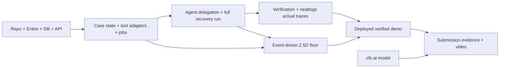

# Nentra — Hackathon Project & Execution Plan

> **Version:** 1.0 — planned 11 October 2026, approximately 21:04 WAT (Nigeria)  
> **Project:** **Nentra** — visually observable Nigerian merchant order-recovery agents  
> **Event:** neatHack 2026  
> **Critical submission window:** Monday **12 October 2026, 14:30–19:25 WAT**, based on published **19:00–23:55 IST** window. **Discord controls final cutoff.**  
> **Strategy:** ready to submit at opening (14:30 WAT); use later window only as contingency.  
> **Related:** [`PRD.md`](PRD.md) · [`TRD.md`](TRD.md) · [`architecture.md`](architecture.md)

## 1. Mission and locked scope

Build a **working, visually observable, multi-agent pre-dispatch recovery workflow** for a fictional Nigerian merchant. A merchant watches actual AI agents receive a blocked order, delegate tasks, request missing information, encounter a genuine courier-quote failure, recover safely, book a shipment through a sandbox adapter, and independently verify the new booking record.

**Must ship:** persisted runs, actual bounded subagents, case events, 2.5D visual floor, right-side activity panel, recovery, safeguards, verification, neatlogs real traces, Entire real checkpoints, cfo.ai real financial plan, deployed demo, public repo and ≤3-minute video.

**Do not ship during timebox unless everything above passes:** generic chat assistant, many scenarios, live WhatsApp/Instagram integrations, actual physical parcel delivery, payment settlement, a full simulator/game engine, broad multi-tenant onboarding, marketplace, elaborate mascot inventory.

## 2. Dates, time and competition reality

### Time conversion

- Official submission opening: **Mon 12 Oct 2026 19:00 IST = 14:30 WAT**.
- Planned submission close: **Mon 12 Oct 2026 23:55 IST = 19:25 WAT**.
- The announced **final cutoff in Discord overrides website estimates**.
- A public **quote-post of the organizer's official X submission post** is the submission mechanism; a prepared draft or ordinary standalone post is not sufficient.
- Include the team name, project name, short product description, public repository, demo link; preserve the official post as quote and comply with any updated Discord fields.
- Hackathon requires a public repo whose code commits were made during the approved October 10–12 window, and a demo of **three minutes or less** explicitly covering all three partner technologies.

### Scoring lens

| Criterion | Weight | Our evidence |
|---|---:|---|
| Agent end-to-end execution | 30% | One resolved case with actual tools, delegated tasks, recovery and independent verification |
| neatlogs + Entire + cfo.ai | 25% | Before/after traces, checkpoints/graph, real financial plan |
| Demo video | 20% | Clear narrated 2.5D work and each mandatory integration |
| Building in public | 15% | Meaningful progress posts tagged `#neatHack`, not spam |
| Usefulness + originality | 10% | Nigerian merchant problem, autonomous exception resolution and visual trust |

## 3. Critical path (build sequence)

**The first true milestone is not a landing page. It is a complete, real backend case that ends with a verified booking.** The UI then projects that workflow live. Partner instrumentation begins early, not at the end.



### P0 acceptance before polishing

```text
Given the seeded fictional order NG-2048 with missing address and a quote fault,
When the operator starts a run and the test customer submits missing information,
Then the controller delegates real agent tasks, a quote attempt fails,
And a recovery decision selects a permitted retry/fallback,
And any required cost approval is enforced,
And exactly one sandbox booking is created,
And a verifier independently reads that booking and issues a PASS receipt,
And the 2.5D canvas + event rail render exactly these persisted steps,
And a browser refresh restores the same truth.
```

## 4. Hour-by-hour delivery schedule (WAT)

A high-intensity plan, anchored to the known 21:04 WAT point on 11 October. Treat intervals as **time budgets**, not guaranteed completion. Assign a short break when needed without moving the submission gate.

| WAT window | Output | Exit check / decision |
|---|---|---|
| **11 Oct 21:05–22:00** | P0 setup: repo, `.env.example`, deployment target, Postgres connection, Entire on Pi, neatlogs account/key, sponsor signup | Public repo initialized, DB connects, Entire status enabled, no secrets committed |
| **22:00–00:30** | P1 domain slice: schema, seed, case API, event journal, worker job/lease, state machine | Case survives process restart; API returns ordered events |
| **12 Oct 00:30–03:30** | P2 agent action slice: controller/investigator/liaison, correction form, fulfillment, real quote-tool fault, recovery, guarded booking, independent verifier | Full seeded run produces real DB receipt and `RESOLVED` (or honest escalation) |
| **03:30–06:00** | P3 visual slice: premium layout, 2.5D stations/characters, task handoffs, error/recovery movement, right rail | Every animation comes from saved event sequence; refresh syncs |
| **06:00–08:00** | P4 tracing + evidence slice: neatlogs wrapper/spans, actual event/trace linkage, Complete B0 and B1 comparison setup | See a real trace with error + recovery, stable evidence paths |
| **08:00–10:00** | P5 quality slice: tests for no double-book, approval, pause/resume, invalid correction, verification mismatch; fix only blockers | Typecheck/tests pass; complete run repeatable; before/after evidence captured |
| **10:00–11:30** | P6 business/deploy: cfo.ai revenue/cost/runway model; deployment; smoke on public URL | Real business export, deployed worker and web working independently of laptop |
| **11:30–13:00** | P7 demo production: script, record live real run, edit ≤3:00, on-screen sponsor artifacts, voice/music if time | Video clear, honest, playable, matches actual product |
| **13:00–14:30** | P8 submit-ready: README, evidence links, X progress and final quote-post text, final smoke | All requirements checked; submission package ready **before opening** |
| **14:30 onward** | Quote official submission post as soon as live; verify publication. If blocked, fix within window | Actual public X quote exists before Discord-confirmed cutoff |

**Hard stop rule:** after **10:00 WAT on 12 October**, stop adding features unless needed for end-to-end correctness or judging evidence. After **12:00 WAT**, prioritize working video/submission over further polish.

## 5. Development methodology with Pi

The user already has a Pi-assisted engineering workflow and Fast-Ship skills. Use it intentionally:

- For the **whole fresh multi-slice MVP**, start using **`/skill:fast-build`** if that workflow tracks milestones in `.fast-build/STATE.md` and executes **one meaningful vertical slice per fresh Pi session**.
- For a bounded individual feature or fix after the base exists, use **`/skill:ship-slice`** by default; do not run a broad repo audit for a small fix.
- Use `/skill:repo-scout` only when repository state is genuinely unknown or recovery/recon is required.
- Each Pi prompt should specify goal, repository truth, slice boundaries, acceptance tests and verification; **do not restate the skill manual**.
- Keep implementation prompts under **7,000 characters**, split by slices.
- Preserve unrelated working-tree changes; commit only related files; no speculative refactors.
- Run one focused verification round per slice (typecheck + relevant tests + smoke), then commit.

### Suggested slices and commit sequence

| Commit checkpoint | Scope | Required evidence |
|---|---|---|
| `feat: initialize nentra foundation` | Repo, schema and migration, core UI shell, Entire config | Git date, Entire checkpoint |
| `feat: persist recovery cases and job events` | Order/case/event DB and APIs | API smoke output |
| `feat: execute delegated recovery workflow` | Agents, customer correction, sandbox failure and safe booking | Persisted run/receipt |
| `feat: visualize agent execution floor` | Live stations, right rail, replay | UI recording; event alignment |
| `feat: instrument neatlogs and prove recovery` | Live traces and B0/B1 checks | Actual trace links/screenshots |
| `docs: package business model and submission evidence` | cfo.ai export, README, video references | Complete evidence index |

Use more/fewer commits as natural; do not make empty commits just to hit a count. Verify Entire checkpoint presence rather than assuming the hook worked.

## 6. Workstream breakdown and definition of done

### WS-1 — Domain + DB + runtime (critical)

**Build:** merchant/order/case/run/task/event/bookings/evidence tables, transitions, queue/leases, resume, idempotent start/booking, fictional demo seed.

**Acceptance:** `start → event flow → real booking write → verifier PASS`, with no unsafe side effects or duplicate booking after a second start.

**Dependencies:** DB connection, Node worker process, schema migration.

### WS-2 — Actual agent intelligence (critical)

**Build:** controller delegates narrow goal to investigator, fulfillment and recovery tasks (at least two real LLM-backed specialist calls); use Zod schema outputs and role tool allowlists. Customer liaison may be structured/deterministic; verifier deterministic.

**Acceptance:** task outputs and delegation visible in DB; different task IDs and owners; failures result in bounded alternate action and user-readable decision summaries; invalid model response fails closed.

**Dependencies:** WS-1, LLM key.

### WS-3 — Real adapter failure + recovery (critical)

**Build:** DB-backed sandbox shipping adapter, rate quotes, one-shot persisted 503 fault, alternate courier, booking reference, separate booking readback, policy price ceiling and approval pathway.

**Acceptance:** actual adapter tool failure appears in neatlogs and events; can reproduce from reset; second plan succeeds; no fake live courier claim.

**Dependencies:** WS-1 and WS-2.

### WS-4 — Customer action + approvals (critical)

**Build:** signed or opaque correction token, address form and validation, conditional cost-approval UI, task resumption.

**Acceptance:** missing detail cannot be hallucinated; bad token rejected; no booking while approval pending.

**Dependencies:** WS-1.

### WS-5 — Agent operations floor (critical experience)

**Build:** premium desktop-first UI, SVG/CSS isometric stations, distinguishable agents, event-bound walk/task-token animations, panel showing concise decisions/errors/evidence, current case state and sandbox badge.

**Acceptance:** live backend changes move characters; page refresh reconstructs state; simulated outage is visibly a real event, not a static clip.

**Dependencies:** event API contract from WS-1.

### WS-6 — Hackathon sponsor evidence (critical)

**neatlogs:** install and initialize official SDK, nested real workflow/agent/tool spans, capture a controlled failed baseline and an improved recovery version, show actual trace links/screenshots and factual comparison table.

**Entire:** enable on repo *before major coding*, verify Pi hooks, produce normal commits and real checkpoints; public evidence.

**cfo.ai:** create actual financial model (merchant plan, per-case expenses, base/upside/downside revenue, runway); export/share real artifact.

**Acceptance:** a reviewer can access/check each evidence item. A README statement alone is insufficient.

### WS-7 — Release and submission (critical)

**Build:** always-on deployment, fictional demo case, README, evidence directory, demo video ≤3 minutes, progress posts tagged `#neatHack`, official quote-post submission.

**Acceptance:** fresh incognito user sees case in read-only mode, operator can run controlled demo, worker doesn't require active local terminal, public video and repository work.

## 7. Dependency and environment checklist

### Accounts and credentials (do now)

- [ ] Register / team web check-in; confirm Discord updates and final cutoff.
- [ ] Obtain neatHack LiteLLM model key via the official team check-in process, if available; validate issued endpoint and model IDs.
- [ ] Create neatlogs project/API key; validate first trace appears on dashboard.
- [ ] Install Entire CLI; run `entire enable --agent pi` inside initialized git repo; run `entire status`.
- [ ] Create cfo.ai hackathon account, understand payment/trial terms; cancel paid subscription as instructed by organizers if applicable and confirm account status.
- [ ] Create hosted PostgreSQL database and production deploy target; configure secrets server-side.
- [ ] Optionally request Shipbubble **test** API key; do **not** block MVP on it.
- [ ] Check fictional demo customer data and payment flag; never upload real buyer addresses.

### What to do if unavailable

| Blocker | Fallback |
|---|---|
| No Shipbubble credentials | DB-backed sandbox adapter (still real tool execution); clear sandbox labels |
| No sponsored LiteLLM key | Use another explicitly authorized model key if available, with cost cap |
| Graphics not ready | SVG characters/isometric platforms + truthful event animation first |
| Real-time SSE unreliable | Delta polling every ~1 second |
| cfo.ai export link unavailable | Save actual screenshots/files and their assumptions in `evidence/cfo/`; don't fake source |
| Entire graph command unavailable | Capture real `entire status`, checkpoint list/explain and commit metadata |
| Worker can't run on selected host | Move runtime to always-on Node host; do not rely on request handler |
| Final scope running late | Cut extra effects, customer messaging and second scenario; **never** cut real recovery, verification or mandatory evidence |

## 8. Explicit fallback tiers

### Gold (ideal within time)

- Full scenario + multiple LLM specialist agents + controlled recoverable fault + approval + independent verification.
- Polished 2.5D animated floor, event replay and case receipt.
- Real Shipbubble test integration only if independently validated.
- Verified neatlogs before/after, Entire checkpoints, cfo.ai plan and polished demo.

### Silver (acceptable under pressure)

- Same authentic sandbox backend flow and safety invariants.
- Simplified visual stations/characters, right rail + step-to-step movement.
- No live shipping integration, no interactive timeline scrubbing, just event replay/status.
- All three sponsors' evidence still real and included.

### Bronze (minimum eligible rescue)

- One actual autonomous recovery run with delegated specialist executions, real injected provider failure, bounded fallback, verified sandbox booking, and a clearly labeled event-driven floor.
- Screenshots for partner proofs, live traces, checkpoint output, cfo.ai plan, public repo and concise demo.

**Never downgrade to a static storytelling demo** with claims of executions that did not occur.

## 9. Failure-injection and before/after evidence protocol

Judges are asking for the agent **to improve**, not just for a single success screenshot.

### Baseline B0 — controlled reproducible failure

1. Seed exactly the same fictional case, price ceiling and one-shot quote fault.
2. Use an initial implementation where the agent recognizes quote failure but has no fallback route (or has an explicitly bounded incomplete recovery policy).
3. Run to `ESCALATED/UNRESOLVED`; store trace and measured elapsed time, tool attempts, token usage if available, and code commit.
4. Label the fault as **controlled sandbox injection**, not a real external outage.

### Improvement B1 — recovered verified result

1. Commit a substantive change to recovery classification/selection and safe fallback logic.
2. Reset to identical seeded inputs and identical initial fault schedule; record the new code commit.
3. Run: preferred quote fails, recovery agent chooses eligible alternative, provider sandbox books, independent verifier issues PASS.
4. Store B1 trace(s), receipt, run event screenshot and exact metrics.

### Compare results honestly

| Metric | Baseline B0 | Improved B1 |
|---|---|---|
| Seed/fixture | Same order + same one-shot fault | Same order + same one-shot fault |
| Outcome | Measured failure state | Measured verified booking state |
| Recovery behavior | Measured; no successful fallback | Measured fallback and safe booking |
| Tool attempts | Fill actual count | Fill actual count |
| Elapsed seconds | Fill actual measurement | Fill actual measurement |
| Tokens/LLM cost | Fill actual if instrumented | Fill actual if instrumented |
| neatlogs URLs | Paste actual IDs/links | Paste actual IDs/links |
| Git commits | Actual baseline commit | Actual improved commit |

Do not claim "X% cheaper" or "Y× faster" unless same-unit measurements support that statement. In a stronger recovery system, B1 may consume more tokens/time than an early-failing B0: **success with safe verification is the primary improvement**, not misleading speed.

## 10. Frontend design requirements / build order

### Foundation before spectacle

1. Live case header and honest sandbox indicator.
2. 2.5D floor with six stations, recognizable small character tokens, task parcel.
3. Side rail with current owner, concise explanation and actual event cards.
4. Failure visibly changes station state; recovery assignment traverses the floor.
5. Verified booking animates only after independent receipt creation.
6. Pause/approval screen is actually usable; reduced-motion/compact text fallback.
7. Only then add environmental flourishes, shadows, animated paths, polish.

### Visual quality check

- Readable at 1280×720 demo recording size, including right rail.
- Clear status labels and strong typographic hierarchy.
- No image-generation dependency; SVG/CSS fallback is production-sufficient.
- Do not use raw SQL, JSON, stack traces or terminal logs as primary UI.
- A judge understands which agent is active and why within five seconds.
- Replay animation uses real event sequence, never predetermined UI timers alone.

## 11. cfo.ai business modeling worksheet

Prepare **assumptions** to enter into the actual tool; these are not validated financial forecasts:

| Variable | Base scenario assumption | Sensitivity |
|---|---|---|
| Monthly subscription | ₦20,000/merchant | ₦10k / ₦30k tiers |
| Paid merchant count | 50 | 20 downside / 150 upside |
| Cases per merchant/month | 80 | 30 / 200 |
| LLM calls per case | Derived from live run measurements | + retries / token spikes |
| Monthly infra | From chosen hosting/database quote | Fixed + variable |
| Shipping charges | Treat as merchant/pass-through unless margin supported | Do not count gross merchandise sales as Nentra revenue |
| CAC/retention | Explicit estimates only | Model churn impact |
| Exchange rate | Current dated assumption if comparing USD APIs to NGN | Show rate and source |

Model revenue, gross margin and cash runway in **cfo.ai**, export screenshots/data and link it. Avoid claiming projected customers, validated pricing or actual ROI without customer interviews.

## 12. Demo video structure (maximum 180 seconds)

**Target runtime: 155–170 seconds** to stay safely under three minutes. The demonstration should show the *actual app*, not just a motion graphic.

| Segment | Approx. seconds | On-screen content | Message |
|---|---:|---|---|
| Hook / Nigerian pain | 0–18 | Order #NG-2048 gets stuck; merchant stack context | Sales should not stall between WhatsApp and dispatch |
| Product reveal | 18–35 | Nentra live 2.5D floor, side panel | An AI ops team the merchant can see and trust |
| Agent delegation | 35–65 | Controller → investigator → liaison; customer correction returned | Real specialist work, not conversation-only |
| Failure and recovery | 65–105 | Real quote 503 + recovery avatar + alternate courier | Failure is detected, classified and repaired safely |
| Verify and result | 105–125 | Booking intent, unique reference, verifier check and receipt | Verified booking, not claimed delivery |
| neatlogs + Entire | 125–150 | Actual traces B0/B1 and checkpoint/graph | Observable runtime and traceable code improvement |
| cfo.ai + closing | 150–170 | Actual cost/revenue/runway plan; project + GitHub | Useful business with auditable economics |

**Video acceptance:** captions readable at 1080p if recorded there, voiceover intelligible, no clipped scenes, no confidential data, clear attribution to each sponsor. Submit ≤180 seconds (not 3:01).

## 13. Building in public / community

Publish short, genuine progress posts on X with **`#neatHack`** (and mention/quote the organizer appropriately). No purchased engagement or synthetic buzz.

Suggested updates:

- **Post 1:** Nigerian merchant problem, Nentra promise and why a visual operations floor matters.
- **Post 2:** Clip of real agent handoff and side rail with actual backend events.
- **Post 3:** Controlled quote failure → recovery; transparent note that it is sandbox fault injection, with measured result.
- **Post 4:** neatlogs trace comparison + Entire checkpoint and cfo.ai model progress, then final demo/submission.

Capture all actual post links under `evidence/submission-links.md`. Do not spam or make unsupported prize/winner claims.

## 14. Final release readiness checklist

### Product

- [ ] `NG-2048` fictional seed and sandbox badge visible.
- [ ] Real controller and at least two specialist agent executions with delegated task records.
- [ ] Customer correction/resume works through UI.
- [ ] Primary tool genuinely fails; recovery handles it within bounded rules.
- [ ] Merchant cost/approval policy enforced.
- [ ] Exactly one booking recorded; independent readback yields PASS.
- [ ] 2.5D avatars and right rail reflect actual persisted events.
- [ ] Refresh/reconnect does not lose state or invent work.
- [ ] Public view is safe; operator mutations protected.

### Verification

- [ ] Relevant automated tests passing and recorded.
- [ ] At least one completed, verifiable full run on deployed app.
- [ ] B0/B1 actual neatlogs trace links or screenshots + numeric comparison.
- [ ] Entire checkpoint metadata/graph evidence accessible.
- [ ] cfo.ai-generated financial plan covering pricing, costs, revenue and runway.
- [ ] All artifacts present in repository `evidence/` (not placeholder text).
- [ ] No secrets, customer PII, or unsupported real-world claims in repo/video.

### Submission

- [ ] Public GitHub repo with eligible hackathon-dated commits.
- [ ] Professional README with what problem it solves, demo URL, setup, constraints and evidence links.
- [ ] Demo ≤3 minutes, publicly viewable and understandable without login.
- [ ] Meaningful build-in-public X posts tagged `#neatHack` linked.
- [ ] Official submission post exists; quote-post includes required fields and working repo/video links.
- [ ] Final cutoff **rechecked in Discord**.
- [ ] Final public quote-post opened and verified as published before cutoff.

## 15. What to do immediately after receiving this plan

1. Create new `nentra` git repository, verify `git status`, **enable Entire for Pi before significant coding**, then create first real checkpoint.
2. Obtain neatlogs key/model access; start with a tiny live trace probe and record only the real output.
3. Initialize Postgres and schema; implement the **vertical path to a verified sandbox booking** before making the UI cinematic.
4. Feed the other three specs to Pi. Execute bounded slices in order, not an uncontrolled instruction to build everything at once.
5. Keep a visible acceptance checklist and stop feature additions by 10:00 WAT on 12 October.

## 16. References and fact-check boundaries

- Official rules/judging: https://neatlogs.com/hackathon
- neatlogs TypeScript SDK: https://docs.neatlogs.com/sdk/typescript
- Entire Pi hooks/CLI: https://github.com/entireio/cli
- cfo.ai event access: https://cfo.ai/neathacks
- Shipbubble optional testing: https://docs.shipbubble.com/get-started

**Planning assumptions:** a hosted Node deployment and Postgres database will be available; the sponsor model key may be limited; live Shipbubble test credentials may not arrive. Plan for the truthful DB-backed sandbox first. Any live API integration must be independently verified before being shown as such.
